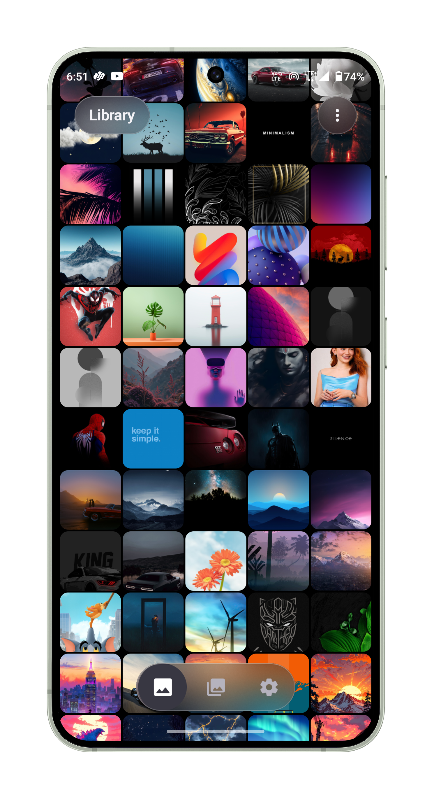
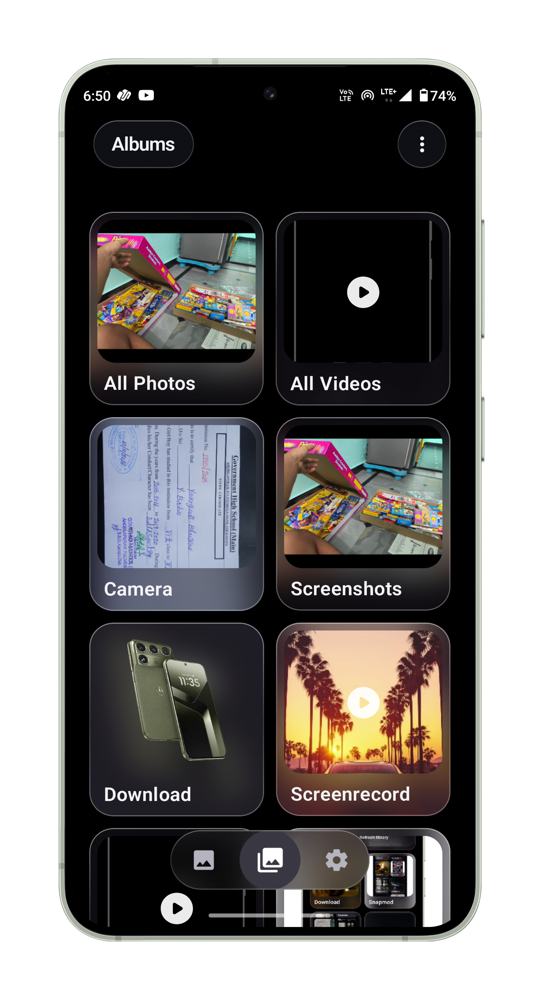
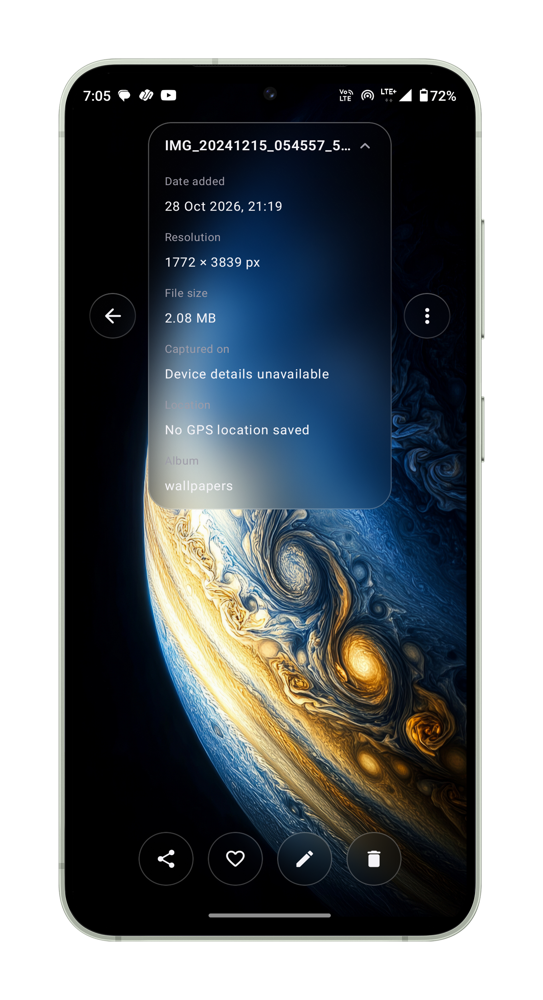
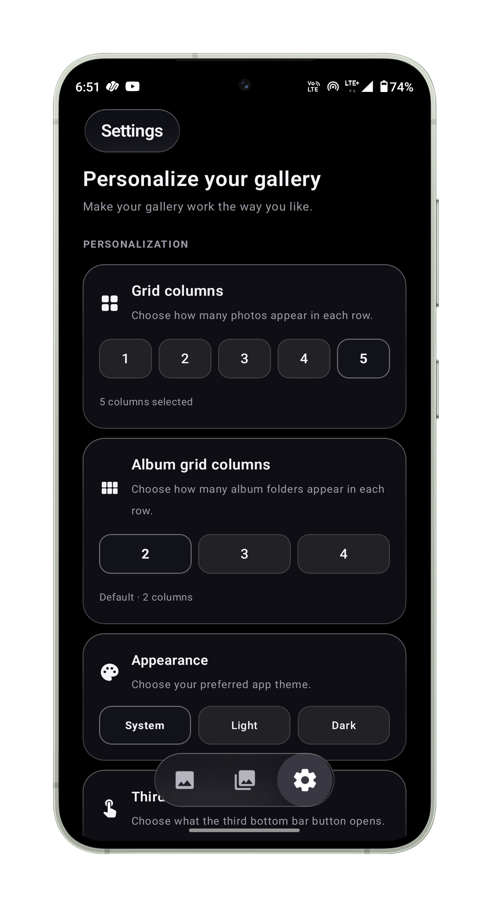

# Photo Gallery

<p align="center">
  <strong>A modern, privacy-first Android photo and video gallery featuring a signature frosted-glass interface, intuitive gesture navigation, and robust built-in editing.</strong>
</p>

<p align="center">
  <a href="https://github.com/janardhan-dev/Photo-Gallery/releases"></a>
  
  
  
</p>

---

## Table of Contents

- [About the App](#about-the-app)
- [Screenshots](#screenshots)
- [Features](#features)
- [What's New in V1.3](#whats-new-in-v13)
- [Technology Stack](#technology-stack)
- [Installation](#installation)
- [Project Structure](#project-structure)
- [Privacy and Security](#privacy-and-security)
- [Roadmap](#roadmap)
- [Contributing and Feedback](#contributing-and-feedback)
- [Author](#author)

---

## About the App

**Photo Gallery** is an open-source Android media gallery crafted with **Jetpack Compose** and **Material Design 3**. It combines a fluid, responsive user experience with a signature frosted-glass aesthetic powered by backdrop blur effects.

Designed with personal privacy at its core, Photo Gallery operates entirely on-device without telemetry, cloud trackers, or mandatory online services. Users can browse, organize, edit, and safely store their memories with hardware-backed biometric security and sanitize EXIF metadata before sharing media with other applications.

---

## Screenshots

## Screenshots

<p align="center">
  
  
  
  
  
  
</p>

| Albums Overview | Photo Library | Selection Mode | Albums Menu | Settings Preview |
|:---:|:---:|:---:|:---:|:---:|
| Dynamic folders & configurable grids | Date-grouped timeline with smooth scrolling | Multi-selection batch operations | Frosted context actions & options | Flexible bottom navigation & themes |

---

## Features

### Media Browsing & Timeline
- **Date-Grouped Library:** View media organized cleanly by chronological timeline groups.
- **High-Performance Caching:** Thumbnail decoding and memory caching powered by Coil Compose for stutter-free scrolling across large collections.
- **Unified Media Grid:** Seamlessly displays both high-resolution photos and video content in a responsive grid layout.
- **Fast Scrolling & State Preservation:** Maintains scroll positions when toggling between albums and returning from full-screen media views.

### Albums & Folder Management
- **Automatic Folder Detection:** Discovers media directories dynamically from device storage (DCIM, Pictures, Downloads, WhatsApp, and more).
- **Dedicated Categories:** Quick-access shortcuts for Camera, Screenshots, Videos, and Favorites.
- **Configurable Grid Layouts:** Switch freely between 2, 3, or 4 columns with responsive typography tailored to card width.
- **Customizable Sorting:** Sort albums by name or item count to quickly locate media collections.

### Photo Viewer & Gesture Engine
- **Physics-Based Double-Tap Zoom:** Double-tap to smoothly zoom to 2.5x with spring physics animations, and double-tap again to reset.
- **Pinch-to-Zoom & Panning:** Smooth multi-touch gesture scaling with edge-bounded panning to keep photos in frame.
- **Swipe Transitions:** Horizontal edge-swiping between adjacent photos with smooth snapback.
- **Immersive Fullscreen:** Tap anywhere to toggle system bars and floating toolbars for an uninterrupted view.

### Video Playback
- **Embedded Media3 ExoPlayer:** Hardware-accelerated video playback supporting modern codecs.
- **Frosted-Glass Playback Controls:** Elegant floating control overlay with play/pause, progress scrubber, and mute controls.
- **Aspect Ratio Fidelity:** Videos scale naturally according to their native aspect ratios.

### Built-in Photo Editor
- **Transform & Crop:** Crop with preset aspect ratios (Freeform, 1:1, 4:3, 16:9), rotate 90 degrees, or flip horizontally/vertically.
- **Color Adjustments:** Fine-tune brightness, contrast, and saturation with instant live preview.
- **Artistic Filters:** Apply styled color presets including Grayscale, Sepia, Vintage, Vivid, Warm, and Cool.
- **Doodle & Markup:** Freehand drawing brush with customizable colors and stroke widths.
- **Text Overlays:** Add custom text annotations directly onto photos before saving.

### Privacy-First Safe Vault (Private Folder)
- **Biometric Authentication:** Hardware-backed protection requiring fingerprint, face unlock, or device PIN via AndroidX Biometric.
- **Encrypted Local Storage:** Media files moved into the Private Folder are migrated into app-internal isolated storage, completely hidden from Android MediaStore and third-party apps.
- **Safe Recovery:** Restore items back to their original MediaStore folders at any time.

### Recycle Bin
- **Two-Step Deletion:** Protects against accidental deletion by staging removed photos in a dedicated recovery bin.
- **Full Restoration & Permanent Purge:** Inspect deleted items, restore them to their original location, or permanently remove them to free up disk space.

### Privacy-Preserving Sharing
- **Dual-Option Share Flow:** Choose between sharing with original metadata or sharing a sanitized copy.
- **EXIF Stripping Engine:** Removes GPS geolocation coordinates, camera model, hardware serial numbers, and device details from JPEG, PNG, and WebP images.
- **Isolated Cache Processing:** Stripping operations occur in temporary cache files via secure `FileProvider` URIs, never modifying original files on disk.

### GitHub Update Checker
- **Direct GitHub Releases Integration:** Check for application updates directly from the official repository via Settings > About.
- **Semantic Version Comparison:** Automatically parses release tags and notifies users when an update is available.
- **Changelog Preview:** Displays release notes and provides a one-tap link to download the latest APK from GitHub Releases.

### UI Customization & Themes
- **Adaptive Themes:** Full support for pure Dark Theme (`#0D0C12` background) and crisp Light Theme (`#F8F7FC` background), with automatic system theme synchronization.
- **Customizable Navigation:** Configure the third bottom navigation destination to open Settings, Favorites, or the Private Folder directly.
- **Frosted-Glass Aesthetic:** Signature backdrop blur surfaces implemented with Haze across top bars, floating bottom navigation, and dialogs.

---

## What's New in V1.3

Photo Gallery V1.3 introduces major usability refinements, privacy capabilities, and performance enhancements:

1. **Light Theme Photo Viewer Overhaul**
   - High-contrast background styling and crisp system icon coloring for optimal visibility in daylight conditions.
2. **Spring Physics & Improved Gestures**
   - Redesigned double-tap zoom powered by spring animations with edge-bounded panning preventing photo drift.
3. **Gallery Performance & Scrolling Optimizations**
   - Optimized recomposition boundaries, stabilized LazyVerticalGrid items, and enhanced Coil thumbnail keying for smoother scrolling.
4. **Customizable Bottom Navigation Tab**
   - Choose whether the third tab opens Settings, Favorites, or the Private Folder, with settings persisted across app restarts.
5. **Configurable 2, 3, and 4-Column Album Grids**
   - Switch album views between 2, 3, or 4 columns. Album labels feature responsive font sizing and line wrapping to eliminate awkward text truncation.
6. **Metadata Removal on Sharing**
   - Dual-choice sharing dialog allowing one-tap stripping of sensitive EXIF metadata (GPS coordinates, camera specifications, timestamps) before sending media to messaging or social apps.
7. **GitHub Release Update Checker**
   - Integrated update check under Settings > About that compares installed version against GitHub releases with release note summaries.

---

## Technology Stack

| Layer | Component | Version / Library |
|---|---|---|
| **Language** | Kotlin | `2.2.21` |
| **UI Framework** | Jetpack Compose | Compose BOM `2024.09.00` |
| **Design System** | Material Design 3 | AndroidX Material 3 `1.3.0` |
| **Navigation** | Navigation Compose | AndroidX Navigation Compose `2.8.9` |
| **Image Loading** | Coil | `io.coil-kt:coil-compose:2.7.0` |
| **Video Playback** | Media3 ExoPlayer | `androidx.media3:media3-exoplayer:1.5.1` & `media3-ui:1.5.1` |
| **Blur & Effects** | Haze | `dev.chrisbanes.haze:haze:1.7.2` |
| **Authentication** | Biometric | `androidx.biometric:biometric:1.1.0` |
| **Image Metadata** | ExifInterface | `androidx.exifinterface:exifinterface` |
| **Core & Lifecycle** | AndroidX KTX | Core KTX `1.16.0`, Lifecycle `2.9.4`, Activity Compose `1.10.1` |
| **Platform Target** | Android SDK | Min SDK: `33` (Android 13) \| Target SDK: `36` (Android 16) |

---

## Installation

You can install Photo Gallery directly on any compatible Android device (Android 13 or higher):

1. **Download the APK**
   - Navigate to the [Official Releases](https://github.com/janardhan-dev/Photo-Gallery/releases) page.
   - Under the latest **V1.3** release assets, download `app-debug.apk` (or the signed release APK).
2. **Allow Installation from Unknown Sources**
   - When prompted by Android, grant your web browser or file manager permission to install unknown apps (*Settings > Apps > Special app access > Install unknown apps*).
3. **Install and Launch**
   - Open the downloaded `.apk` file and tap **Install**.
   - Launch **Photo Gallery** and grant media permissions when requested to allow the app to index your device's photos and videos.

---

## Project Structure

```text
PhotoGallery/
├── app/
│   ├── build.gradle.kts                   # App-level build config, SDK levels & dependencies
│   └── src/main/
│       ├── AndroidManifest.xml            # Permissions, FileProvider & Activity declarations
│       ├── ic_launcher-playstore.png      # Application launcher store asset
│       ├── java/com/photogallery/
│       │   ├── MainActivity.kt            # Core UI, navigation host, viewer & state orchestrator
│       │   ├── PhotoEditorEngine.kt       # Image manipulation engine (crop, adjust, filter, draw)
│       │   ├── PhotoEditorScreen.kt       # Jetpack Compose photo editing interface
│       │   ├── PrivatePhotoMoveInManager.kt  # Secure migration to private app storage
│       │   ├── PrivatePhotoRestoreManager.kt # Secure restoration from vault back to MediaStore
│       │   └── ui/theme/                  # Material 3 styling tokens (Color, Theme, Type)
│       └── res/
│           ├── layout/                    # Embedded player layout XMLs
│           ├── mipmap-*/                  # Adaptive launcher icons
│           └── xml/
│               └── recycle_bin_file_paths.xml  # FileProvider path configuration for sharing
├── gradle/
│   └── libs.versions.toml                 # Centralized dependency catalog
├── screenshots/                           # Repository preview screenshots
├── build.gradle.kts                       # Root project build configuration
└── settings.gradle.kts                    # Module definitions & repository plugins
```

---

## Privacy and Security

Photo Gallery was designed specifically to prioritize user privacy:

- **Zero Telemetry:** The application contains no analytics SDKs, advertising trackers, or telemetry beacons.
- **Hardware-Backed Biometric Vault:** Items placed inside the Private Folder are removed from the public Android MediaStore and encrypted within the application's sandboxed private storage directory (`Context.filesDir`). Media is decryptable and visible only after successful biometric authentication (fingerprint, face unlock, or device PIN) evaluated by Android's Keyguard/BiometricPrompt system.
- **EXIF Metadata Removal:** When sharing photos, selecting "Share without Metadata" creates a temporary sanitized duplicate in the application's isolated cache. EXIF tags—such as exact GPS coordinates, camera hardware serials, capture timestamp, and focal length—are removed via `ExifInterface` before passing the file to the target application using secure, read-only `FileProvider` URIs. Original media on your storage device is never modified or overwritten.
- **Transparent Permissions:** Only required media permissions (`READ_MEDIA_IMAGES`, `READ_MEDIA_VIDEO`) are requested. Network access is restricted exclusively to checking release tags against the GitHub API.

---

## Roadmap

Planned future features and enhancements:

- [ ] **Video Trimming & Basic Editing:** Quick trim, crop, and mute capabilities for captured videos.
- [ ] **Advanced Media Search:** Filter by date intervals, media dimensions, file extension, and album location.
- [ ] **Custom Album Creation:** Create user-defined virtual albums and custom tag collections.
- [ ] **Batch Metadata Editing:** Manually adjust capture dates and times for scanned legacy photos.
- [ ] **WebDAV / Local NAS Backup:** Optional, privacy-preserving synchronization to private home servers without third-party cloud dependence.

---

## Contributing and Feedback

Contributions, bug reports, and suggestions are welcome:

1. **Report a Bug:** Open an issue on the [GitHub Issues](https://github.com/janardhan-dev/Photo-Gallery/issues) page detailing the device model, Android version, and steps to reproduce.
2. **Suggest Improvements:** Share feedback or propose new features through [GitHub Discussions or Issues](https://github.com/janardhan-dev/Photo-Gallery/issues).
3. **Pull Requests:** Fork the repository, create your feature branch, test your changes thoroughly, and submit a pull request with a descriptive summary of your changes.

---

## Author

**Photo Gallery** is designed and maintained by:

- **Janardhan** — GitHub: [@janardhan-dev](https://github.com/janardhan-dev)
- Repository: [janardhan-dev/Photo-Gallery](https://github.com/janardhan-dev/Photo-Gallery)
