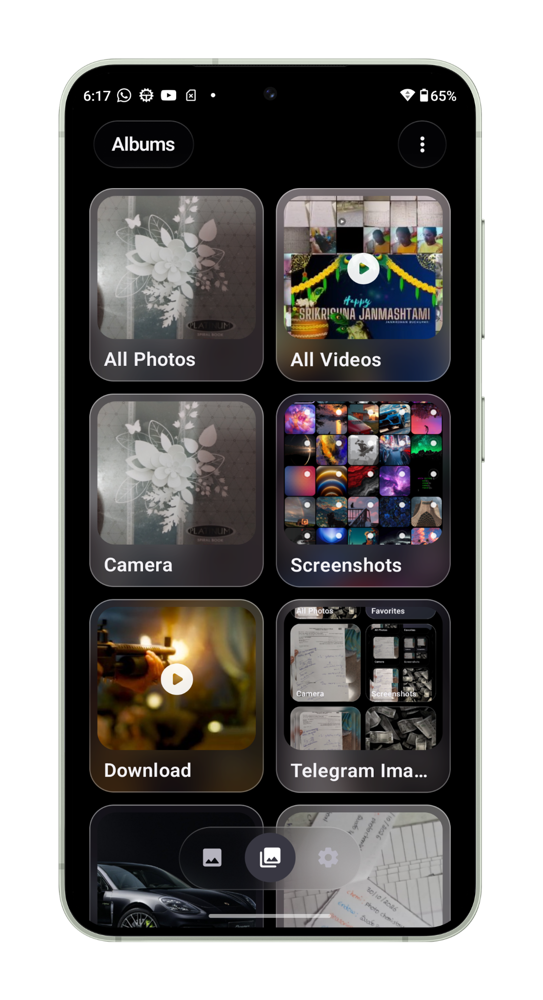
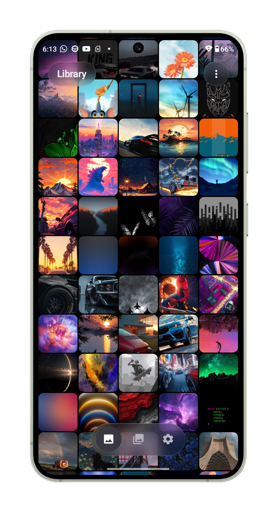
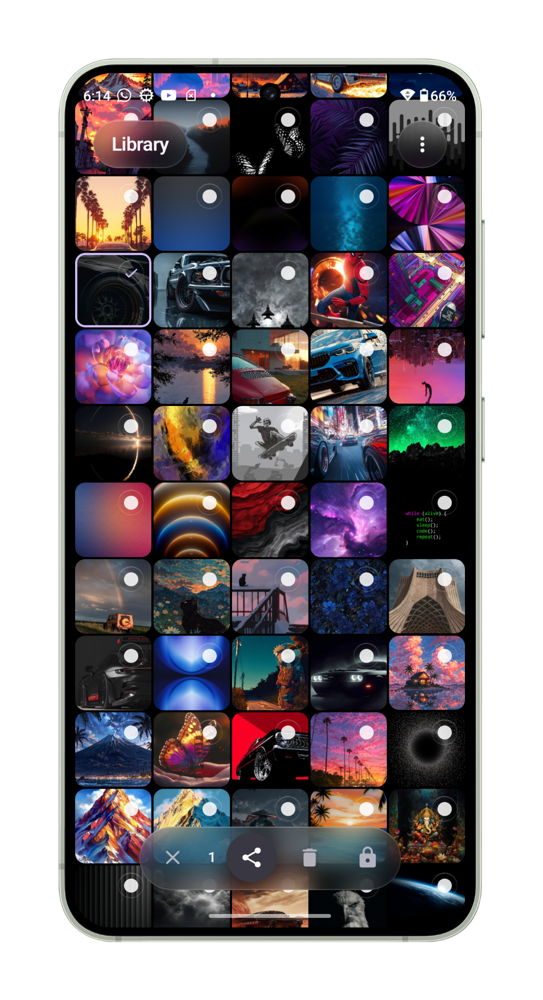
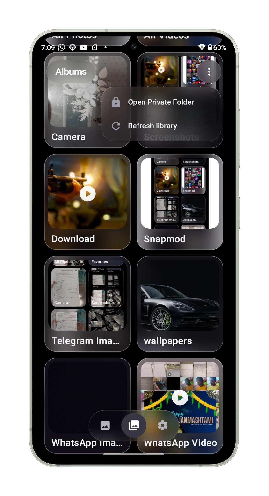
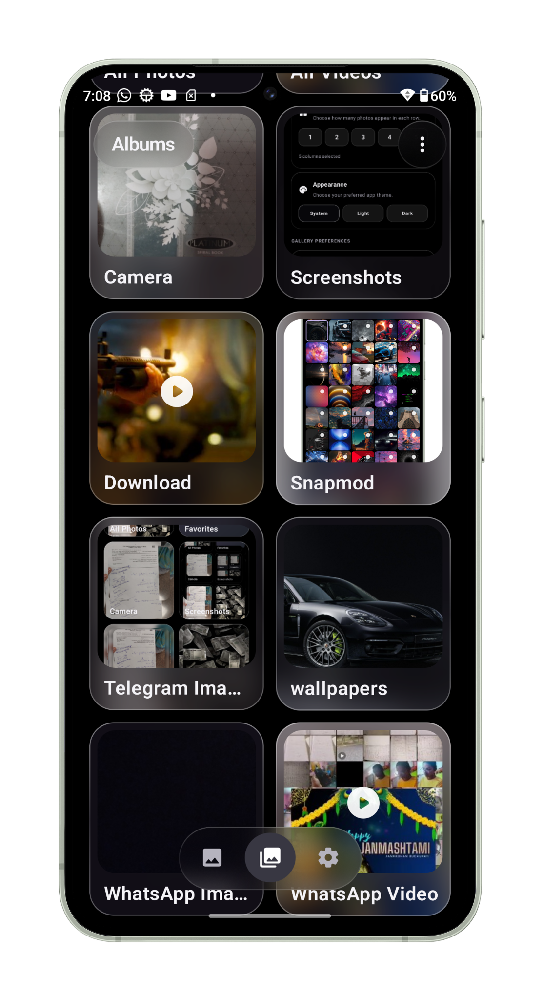

# 📸 Photo Gallery

  A modern Android photo and video gallery with a beautiful frosted-glass interface.

  
  
  

---

## ✨ Overview

**Photo Gallery** is an Android application designed to provide a clean, modern and immersive way to browse and manage photos and videos.

Featuring a distinctive frosted-glass design, smooth navigation and practical media management tools.

## 📱 Screenshots

  
  
  

  
  

## 🚀 Features

- 🖼️ Photo and video library
- 📂 Automatic album organization
- 🎬 Full-screen photo and video viewer
- 🔒 Private Folder
- 🗑️ Recycle Bin
- ⭐ Favorites
- 🎨 Light, Dark and System themes
- ⚙️ Customizable gallery settings
- 💎 Frosted-glass interface

## 🛠️ Built With

- Kotlin
- Jetpack Compose
- Material 3
- Android MediaStore
- AndroidX Media3
- Haze – Blur effects

## 📥 Download

Get the latest APK from the [GitHub Releases](https://github.com/janardhan-dev/Photo-Gallery/releases/latest) page.

## ⚠️ Development Status

This project is under active development. Some features may change, and bugs may occur.

## 💬 Feedback

Suggestions, feedback and bug reports are welcome through the repository's [Issues](https://github.com/janardhan-dev/Photo-Gallery/issues).

---

  Made with ❤️ by <a href="https://github.com/janardhan-dev">Janardhan</a>

